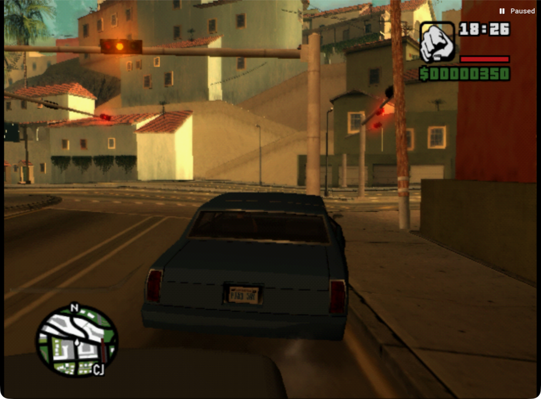

# Pending baseline preparation

**Preparation executed after coordinator handback with calibrated 350 ms timing; fresh-process restore verification pending.** Keep the minute recording and its policy unchanged. Apply the coordinator's current main next-wave policy/schema/control updates only after calibration; record the selected commit and timing with the preparation result.

Purpose: establish a new, stopped, road-aligned right-lane baseline near the current junction and its yellow hillside buildings. A future block attempt must return to this new visual fingerprint after a complete loop. This preparation is not a continuation or success claim for the original garden-wall route.

After explicit handback, use this bounded policy command from this worktree. It relies on the coordinator's approved timing implementation; no independent timing override is chosen here.

```sh
SAN_ASTRA_BRIDGE=/Users/pz/w/oaihackathon/native/astra-bridge \
SAN_ASTRA_PID=69729 \
SAN_ASTRA_FRAME_INTERVAL_MS=350 \
SAN_ASTRA_PCSX2_INI=/Users/pz/.codex/worktrees/4ed4/oaihackathon/.runtime/stream-route/pcsx2/inis/PCSX2.ini \
uv run python scripts/autodrive.py \
  --pid 69729 --run-dir runs/stream-route-baseline-prep-01 \
  --steps 12 --frame-stride 30 --mode stepped \
  --model gpt-6-astra --reasoning-effort low --service-tier fast \
  --policy-transport app-server --bridge-transport cli \
  --vision-max-edge 640 --timeout 120 \
  --goal 'Prepare a new stationary reset baseline near the current distinctive junction with yellow hillside buildings and a signal ahead. Choose every gameplay control from screenshots. Safely stop fully within the RIGHT lane, parallel to the local road edges, clear of the intersection, sidewalks, traffic and pedestrians. Identify two distinctive fixed landmarks and their left/right relationship to the present heading. Do not try to complete a block or return to the original garden wall during this preparation. Confirm standstill by comparing fixed landmarks across consecutive observations separated by your chosen control phase; a Paused overlay alone does not prove zero vehicle motion. Set stop=true only when visible standstill, road alignment, right-lane position and clearance agree. If the bounded preparation ends without that evidence, report incomplete rather than claim readiness.'
```

Review the final observation pair and decision note before saving. If standstill/alignment/clearance are not established, do not capture a scenario or choose manual corrective driving. Report the outcome for coordination.

If the evidence passes, the existing snapshot helper acquires the per-PID controller lock. F1 is an opaque setup save, not a gameplay phase. No extra neutral advancement is needed for the snapshot itself:

```sh
SAN_ASTRA_BRIDGE=/Users/pz/w/oaihackathon/native/astra-bridge \
SAN_ASTRA_PID=69729 \
SAN_ASTRA_FRAME_INTERVAL_MS=350 \
SAN_ASTRA_PCSX2_INI=/Users/pz/.codex/worktrees/4ed4/oaihackathon/.runtime/stream-route/pcsx2/inis/PCSX2.ini \
uv run python scripts/scenario.py \
  --scenarios /Users/pz/w/oaihackathon/.runtime/scenarios \
  capture right-lane-junction \
  --iso '/Users/pz/Documents/Games/Grand Theft Auto - San Andreas (USA) (v3.00).iso'
```

No `--replace`: preserve any existing scenario and `quiet-tahoma`. Retain screenshot pair, model decisions, scenario manifest/checksum, timing choice and source commit. The coordinator must visually verify a restore before using the new baseline for comparisons.

## Authorized preparation started

Coordinator returned PID 69729 after calibration. Integrated policy, schema, wrapper and control files from main 58f9a40. Fresh screenshot at 21:21:49 UTC confirmed current scene near the junction after neutral calibration. Started the 12-decision command with 30-frame stride and 350 ms interval. No full-minute attempt is authorized until root checks a captured baseline.

## Model-controlled result

The model stopped at decision 6 after six actions (180 requested frames) and one final stop decision, within the 12-decision cap. It used braking/handbrake and neutral phases, then confirmed standstill with controls released. The final neutral-separated screenshot pair shows stable car, curb and pole positions; the signal animation differs. Car is road-aligned within the right lane before the crossing, with narrow visible curb clearance. All gameplay controls came from the low/fast screenshot policy. No new full-minute trial started.

Saved new opaque scenario `right-lane-junction` in the shared scenario directory via locked F1 helper. State SHA256: `c4a8ed54b666481f70f29546dfabfc04a68a224bd4a3dfdc189d04fec17ba01f`; 18,842,771 bytes. `quiet-tahoma` remains intact. [Preparation evidence](route-baseline-evidence.json) preserves all seven decisions and capture provenance.


## Fresh-process restore

Terminated only original PID 69729 after saving, then launched the new opaque state in the same profile as PID **68968**. Initial capture was black, so issued 60 neutral redraw requests at the calibrated 350 ms interval. The restored screenshot shows the same car position, right-lane alignment, curb/pole relationship and yellow hillside/red-orange corner landmarks. Clock advanced from 18:25 to 18:26 during redraw; this is a visual match, not a bit-exact replay claim. Capture is off and emulator remains paused. Coordinator visual comparison is pending before any full-minute trial.


