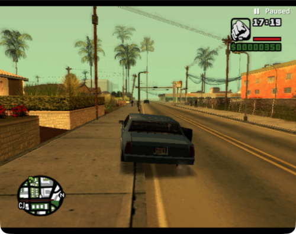
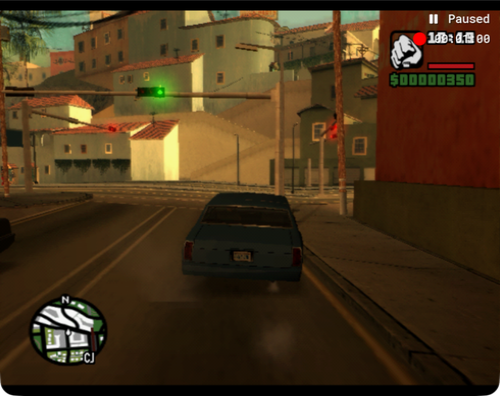
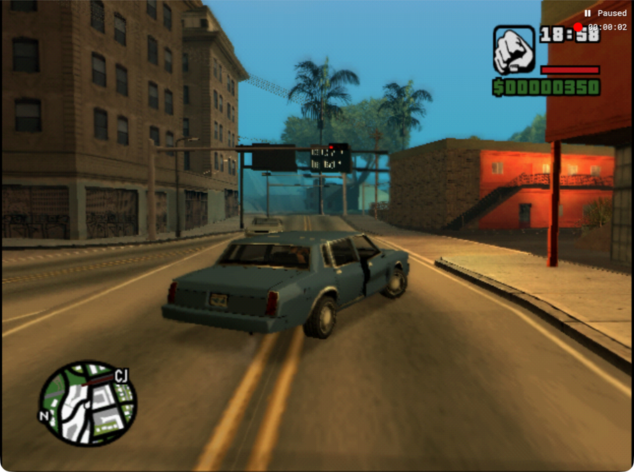
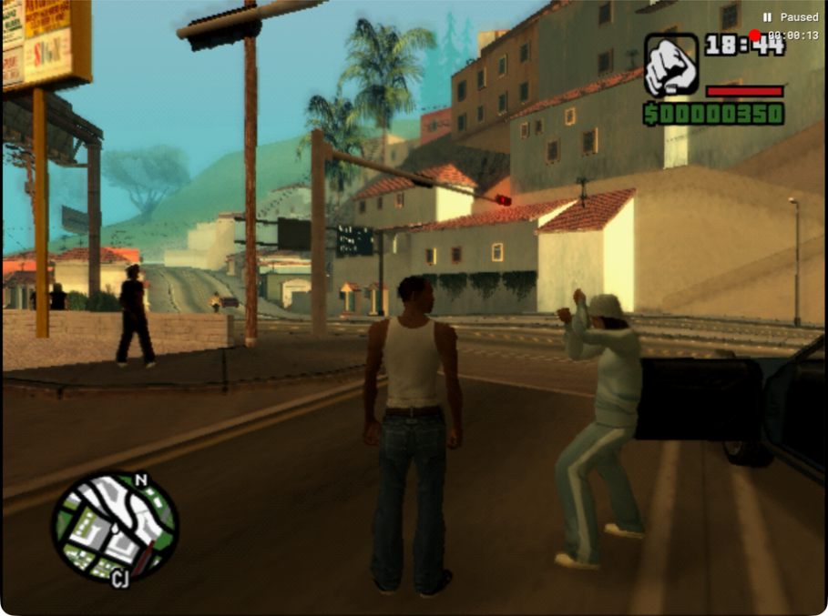

# Route continuity stream

Worktree: `/Users/pz/.codex/worktrees/4ed4/oaihackathon`.
Shared harness: `0ac5edd`; isolated emulator PID `66584`.
Profile: `.runtime/stream-route/pcsx2`; shared read-only scenario `quiet-tahoma`.

## Pretrial change

The driving prompt now preserves an immutable visual start fingerprint (two distinctive landmarks and their left/right relationship to travel direction), explicitly marks a missed circuit unresolved, and requires landmark relationships plus road-edge heading to agree before claiming return. This is general screenshot-only route guidance, without a prescribed driving sequence. Existing model, low reasoning, fast service, input locks, and control policy remain intact.

Prepared baseline with 60 neutral frame requests before capture. One attempt planned: `stream-route-minute-01`, 640-pixel vision, target 3597 actually recorded frames. Every gameplay decision comes from the existing screenshot-only policy. No second attempt before coordination.

## Coordinated stop, no driving trial completed

The daemon startup failed before the first observation (`Native daemon timed out after 15 seconds`). Its driver reported zero decisions/actions/requests. Added an explicit `--bridge-transport cli` wrapper option, preserving daemon as default, then retried the same paused PID with the same prompt/model under `stream-route-minute-01-cli`. CLI captured successfully (199.56ms), but the coordinator requested all streams stop while investigating another stream's unexplained advancement. Sent SIGINT only to owned wrapper PID 67558; it interrupted owned driver 67588 and finalized this PID's recorder. Both processes exited; emulator PID 66584 remains open. No further controls or reset were issued.

Both retained MKVs are 533-byte zero-frame files. Frame counting reports zero; no decodable frames or valid MP4 exists, so no video is manufactured. Each driver summary records zero decisions and zero gameplay frames requested. The CLI attempt was interrupted after 7.054 wall seconds. The recorded minute target was NOT reached. Route return and the prompt improvement are untested.

The last CLI observation visibly says Paused and shows the Tahoma beside the starting garden wall, orange motel across the road, and clock 17:19. This stream's evidence does not establish the cause of other streams' advancement.

Machine-readable provenance: [startup evidence](route-startup-evidence.json). Raw evidence remains in `runs/stream-route-minute-01*`, with both masters under `.runtime/stream-route/pcsx2/videos/`.

## Validation and next step

`tests/test_autodrive.py`: 4 passed, 6 failed, 11 subtests passed. All six failures reproduce against isolated copies of the unmodified shared harness commit 0ac5edd (mock controller PID is not JSON serializable). No live-policy changes were made in response.

Lesson: startup capture and confirmed paused isolation must be established before judging route behavior. Proposed next improvement: coordinator-owned no-input recording verification per isolated PID before restarting the unchanged route policy. After that gate, run one real minute and evaluate whether the fingerprint survives actual turns; do not tune from zero-decision startup failures.

## Corrected harness attempt 02

Coordinator handed back reset/warmed PID 69729 after shared four-game isolation proof:60 recorded frames on the tested PID and zero on the others. Integrated only `control.py` and `daemon.py` from shared main 90149e5, retaining this stream's exact driving prompt. Scoped input now uses `--no-focus`, and CLI screenshots serialize on the shared capture lock. Started `stream-route-minute-02` with CLI bridge, 640 vision, unchanged screenshot-only Astra low/fast and route goal. No additional warmup/reset in this stream. One real-minute trial authorized.

## Attempt 02 result: full minute, partial route

Completed `stream-route-minute-02` on PID 69729 with one continuous recording, no reset, no action replay, and no driving-policy edits. The emulator remains paused; no new attempt or baseline preparation has started.

| Measure | Observed |
| --- | --- |
| Policy decisions/actions | 80 / 80 |
| Requested VSyncs | 4658 |
| Last live capture lower bound | 3599 |
| Final flushed/decoded source frames | 3611 |
| Full master playback | 60.24 seconds |
| Git replay | 3597 frames, 60.01 seconds |
| Wall-clock driver time | 1771.346 seconds |
| Model decision median | 5365.39 ms |
| Image size | 500×396 pixels;640 was a maximum edge, not upscaling |
| Policy | gpt-6-astra, low, fast; screenshot-only |

The source count is 1047 below requested VSyncs; this evidence alone does not attribute the shortfall to stepping or encoding. No frames were invented or padded. The source master and all 3611 decoded PNGs remain unchanged in the ignored runtime/run paths.

[One-minute replay](../videos/stream-route-minute-02.mp4) · [Video provenance](../videos/stream-route-minute-02.json) · [All 80 decisions and metrics](route-minute-02-evidence.json)

**Route outcome: one right turn, no return to the start.** Decisions 0–10 recovered from the left curb into the right lane, with subsequent curb-clearance correction. Decisions 14–36 were 23 consecutive neutral-only waits at the red signal. Decisions 39–42 attempted and entered the first right turn. The image after that turn showed the vehicle angled toward the curb beside a pole; subsequent decisions corrected curb clearance, then centerline drift. The run ended approaching another junction along the second street, not back at the original wall and motel orientation.

The immutable fingerprint was retained in 80 of 80 route notes: garden wall LEFT, orange Jefferson Motel RIGHT, original heading toward signals. Turn count stayed at 1 and return remained explicitly unverified. This supports memory retention and honest completion reporting in this one run; it does not establish that the prompt improves driving or can complete a loop. No comparative success claim is warranted.

The [preceding image](route-minute-02-before-final.png) and final image show slight forward displacement toward the pole/crosswalk. Final actions were powered forward. Therefore the optional stationary baseline was NOT captured; a separate model-controlled preparation and coordinated handback would be needed.

### Lesson and proposed next improvement

Route memory survived; lane alignment and long waits consumed most of the minute. A route-memory note can remain correct while physical progress is small. After the coordinator's neutral timing calibration, prepare a genuinely stationary, right-lane baseline beside a distinctive landmark using the model. For a subsequent route prompt experiment, require a compact current-leg target (the next visibly connected street) alongside the immutable fingerprint, and distinguish a completed corner from stable destination-lane alignment. Evaluate this only in a new, fixed-policy trial; no second trial has been run here.

Shared control validation: 44 tests passed and 1 failed (`test_step_mapping_and_contract` still expects 35 ms while configured default is 90 ms). The earlier 6 autodrive Mock-serialization failures were reproduced on unchanged 0ac5edd. No test or timing configuration was changed during the trial.

## Single-game attempt 03 started

After coordinator visual restore verification, started `single-minute-03` from `right-lane-junction` on PID 68968 without another reset. Driver PID 69404, wrapper PID 69397. Current shared main 58f9a40 guidance/schema/policy is fixed, with a separate dynamics note and original start screenshot attached. Uses screenshot-only Astra low/fast, CLI bridge, 30-frame decisions, calibrated 350 ms interval, 240-decision safety cap and 3597 actually recorded-frame target. New loop fingerprint: yellow hillside buildings ahead-left, red-orange corner building right, same approach heading. One full-minute trial authorized; no further attempt before coordination.

### Midpoint usage interruption and same-game continuation

Attempt03 stopped on `usageLimitExceeded` after 60 decisions/actions and exactly 1800 requested/decoded frames (30.03 seconds). Last live lower bound was 1787; final flush added 13. Coordinator reported saving an opaque backup without advancing/resetting the paused game. After the user reset Astra usage, resumed the same PID 68968 as `single-minute-03-part2`, target 1797 stored frames,30-frame stride/350 ms, 180-decision safety cap. Driver 75741, wrapper 75728. The wrapper inherited all 60 prior decisions and the original start reference. SHA256 checks confirm `autodrive.py` and `policy.py` exactly match part1. No new guidance, reset or action replay was used; no quota auto-retry loop.

### User-directed pause for real-time burst mode

Part2 stopped at the next completed action boundary after five decisions/actions. SIGINT targeted only driver 75741 after its step 4 recording-progress event; the wrapper finalized capture. Final 150 source frames exactly match 150 requested frames (2.50 seconds). Part1+part2 total 1950 source frames, approximately 32.53 seconds; this is NOT a full-minute result. Remaining target is 1647 frames. Both segments preserve the original 58f9a40 policy hashes and use the same emulator without reset/replay. The mode has not yet changed in this worktree.

The user requested normal-speed gameplay bursts with pauses about every 30 frames, overriding the earlier fixed stepping-mode plan. Handed sole paused PID 68968 back to root with capture off for implementation. No further gameplay inputs, new attempt, or reset performed.

[Part1 replay](../videos/single-minute-03.mp4) · [Part2 replay](../videos/single-minute-03-part2.mp4) · [Partial decisions and capture provenance](single-minute-03-partial-evidence.json)

Observed route remains incomplete: one right turn, pole collision and recovery, with the car still diagonal across the centerline toward the right lane at handback. The final screenshot records the exact handoff view. Source masters and every 1800+150 decoded PNG remain preserved.

## Fresh normal-speed burst attempt 01

Integrated shared main 1000d0c native/control/runner/wrapper, including speed-dependent steering guidance. This is a NEW trial, not a continuation of the 32.53-second partial: root's intervening neutral calibration advanced that prior game. Terminated only old PID 68968, restored unchanged `right-lane-junction` in sole new PID 76989. Initial black required 60 neutral redraw requests at 350 ms; visually matched the same position/landmarks at 18:26. Verified nominal scalar 1; one-time native focus before trial.

Started `burst-minute-01`, driver 77281/wrapper 77270, fresh history, original start reference, low/fast screenshot-only. Burst mode uses 30 nominal-frame plans (~0.5s normal-speed gameplay) then pauses; 240-decision cap, 3597 actually stored-frame target. First five native running durations of 503–525 ms confirmed normal-speed bursts; actual frame count remains measured separately. No additional driving or policy changes outside model decisions.

### User-directed interval change within burst trial

User changed evaluation interval to 60 frames. Stopped first burst driver 77281 immediately after completed step 8. Nine actions budgeted 270 nominal frames; final recording contains 256 actual frames. Wrapper finalized capture; no reset/extra advancement. Resumed same PID 76989 as `burst-minute-01-part2`, driver 77718/wrapper77710, burst mode with 60 nominal-frame plans (~1 second), 3341 remaining actual-frame target. Inherited nine prior decisions, original start reference and exact same policy/goal. This explicit interval boundary belongs to one continuous game attempt; it must be disclosed when combining the recordings.

### Burst trial stopped for requested half-speed inference mode

User superseded pause-during-inference with a request for normal-speed actions and half-speed simulation while the model thinks. Stopped only driver 77718 at the completed step 12 boundary. Part2 finalized **806 actual frames from 780 nominal frame budgets**, 13 completed actions, 13.45 seconds. First part contains 256 actual frames; combined **1062 source frames, about 17.72 seconds**, not a minute. These were approximate timed bursts, so nominal budgets are not delivered-frame claims.

Latest scene: player on foot beside the sedan and an attacker after a carjacking while waiting. Policy attempted vehicle entry using triangle, with zero turns completed. Final image confirms the interrupted state. Handed sole PID 76989 to root paused, capture off, no further gameplay or code changes. Both source masters and all 256+806 PNGs remain preserved.

[First burst segment](../videos/burst-minute-01.mp4) · [60-frame continuation](../videos/burst-minute-01-part2.mp4) · [Decision and capture evidence](burst-minute-01-partial-evidence.json)

## Flow minute completed and reviewed

One fresh `flow-minute-01` completed from the verified right-lane baseline using shared main 1fa50c4. It recorded 3618 native frames (60.36 simulation seconds) and a 109.68-second real-time window movie, with 12 low/fast screenshot decisions. Actual 50% inference and 100% action targets were visually verified in the movie. Zero turns; curb/pole clearance remained unresolved. PID 79892 paused at normal speed; no reset or additional trial.

The [flow review](flow-minute-01-review.md) records the causal limits and next experiment. The [8.55 MB sharing video](../videos/flow-minute-01-share.mp4) preserves original timestamps and full 109.68-second timing. Full-resolution MP4/MOV, lossless native MKV and all 3618 PNGs are retained unchanged.

## Flow minute 02 completed

Fresh baseline trial on sole PID 82617 used shared main 25d84d0: four labeled motion images, measured interval context and model-selected inference controls. Recorded 3683 native frames (61.44 simulation seconds),13 decisions/12 applied actions, and 111.83 seconds of wall-clock video. The target crossed during the final inference; final candidate action was not applied. Handbrake thinking control was selected and transmitted to native e-key holds after the initial neutral choice. Still zero turns, curb/traffic constraints and visible rear damage. [Review and capability evidence](flow-minute-02-review.md). PID remains paused; no reset.
